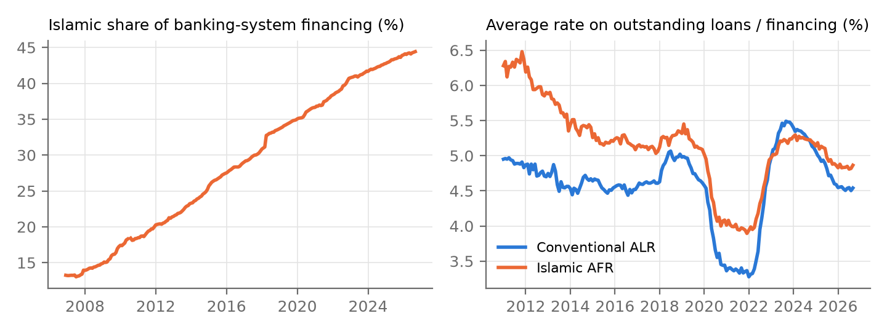
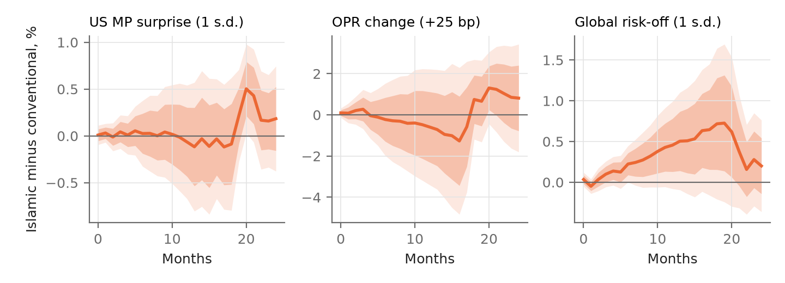
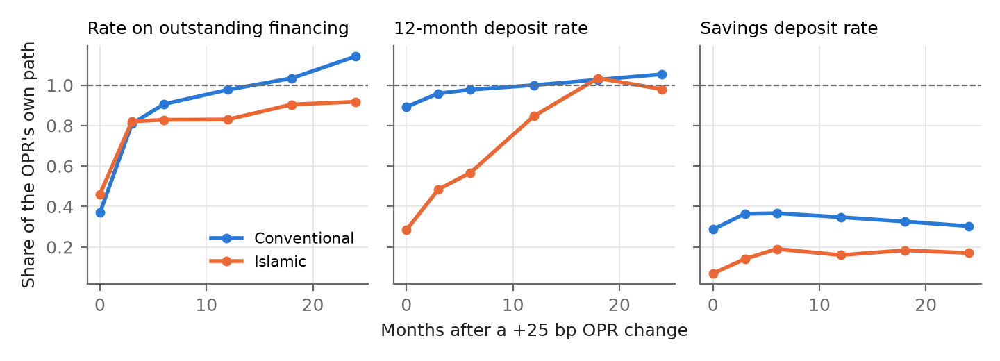
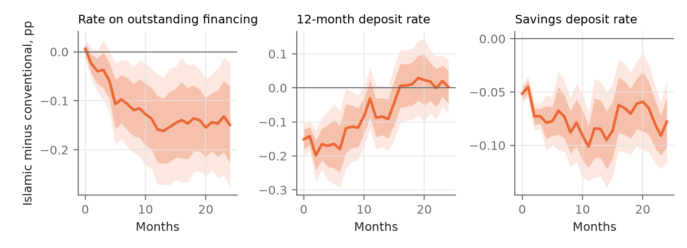

# Same Shock, Different Prices: Islamic and Conventional Banks in Malaysia's Monetary Transmission

*Working paper, draft of 19 November 2026. Comments welcome.*

**Abstract.** Islamic banks cannot charge or pay interest, and much of their financing is written as sale contracts with a price fixed at inception. Do they transmit monetary shocks differently from conventional banks? This paper answers the question inside one country, Malaysia, where the Islamic banking system now holds 44 percent of banking-system financing. Public monthly statistics from Bank Negara Malaysia (BNM) separate Islamic from total financing by loan purpose, deposits by type, and lending and deposit rates, from 2006 (rates from 2011). Comparing Islamic and conventional banks in the same month and for the same loan purpose removes everything common to Malaysia. The shocks are US monetary policy surprises, changes in the overnight policy rate (OPR) and global risk-off shocks. Six primary tests and a multiple-testing correction were fixed before estimation. Credit quantities do not differ: within loan purpose, Islamic and conventional financing respond alike to all three shocks (permutation p = 0.83 and 0.61 for the two primary credit tests), and the null survives every robustness check. Prices do differ. Measured against the OPR's own cumulative path, the average rate on outstanding Islamic financing passes through 0.83 of a policy-rate change after 12 months against 0.98 for conventional loans, while both banks' Base Rates pass through about 1.0. The 12-month Islamic deposit profit rate moves 0.28 on impact against 0.89 for conventional fixed deposits and catches up only after about 18 months; Islamic savings rates pass through about half as much. The book-rate gap is suggestive rather than conclusive (Holm-adjusted p = 0.09) and leans on the 2022-23 hiking cycle; the deposit-rate gap is larger and more robust. Islamic banking in Malaysia smooths the price side of monetary transmission on both sides of the balance sheet without changing the volume of credit.

**JEL codes:** E52, E43, F42, G21, Z12.

**Keywords:** Islamic banking, monetary transmission, interest-rate pass-through, dual banking, local projections, Malaysia.

## 1. Introduction

Islamic finance works differently from conventional banking on paper. Financing is extended through sale contracts (murabaha, bai' bithaman ajil), leases (ijara) or partnerships (musharakah) rather than interest-bearing loans, and depositors either hold guaranteed accounts that earn a profit rate, or investment accounts whose return is meant to depend on the bank's assets. If these differences are real in practice, an economy with a large Islamic banking sector should transmit monetary policy differently: a sale contract signed at a fixed price cannot be repriced when the policy rate rises, and a profit rate set by the bank need not follow market rates.

Cross-country evidence on this question is weak. A companion analysis for this project (panel local projections for 13 dual-banking economies, 2010-2025) found no robust relation between a country's Islamic banking share and its response to US monetary policy or global risk-off shocks: every apparent effect came from one country (Turkey), one episode (2022-23) or a data gap. Country-level comparisons have two problems. The Islamic share is fixed within a country and confounded with everything else that distinguishes the Gulf, Malaysia and the rest. And aggregates can hide differences between banks: if Islamic and conventional banks price differently but borrowers switch between them, total credit need not move.

This paper uses a within-country design instead. Malaysia is the natural case: the Islamic banking system grew from 13 percent of banking-system financing in 2006 to 44 percent in 2026 (Figure 1), it operates alongside conventional banks under one central bank and one set of liquidity rules, and BNM publishes monthly statistics that separate the Islamic banking system from the whole banking system. Subtracting one from the other gives the conventional system. The paper compares the two in the same month and, for credit, for the same loan purpose, so that shocks, demand and everything else common to Malaysia cancel.

The paper tests four hypotheses, fixed before estimation:

- **H1, repricing:** the average rate on outstanding Islamic financing responds more slowly to policy-rate changes than the average rate on conventional loans, because fixed-price sale contracts reprice only as they run off.
- **H2, funding:** Islamic deposit profit rates respond more slowly (a), and the composition of Islamic funding shifts differently (b).
- **H3, credit quantities (primary):** Islamic financing growth responds differently to tightening than conventional lending for the same purpose. Theory allows either sign, so the test is two-sided.
- **H4, risk sharing:** returns to investment-account holders absorb shocks (exploratory; data from 2015).

SME financing, where Islamic and commercial banks' applications and approvals are published separately from 2021, is a fifth, exploratory block.

The results split cleanly. Quantities do not differ (H3 rejected); prices do (H1 suggestive, H2a strong). Islamic banks pass policy-rate changes to the rates they charge on their outstanding book and the rates they pay depositors more slowly, but the volume of credit they extend responds like conventional credit. The deposit-side result is the largest: Islamic 12-month profit rates move about a third as much as conventional fixed-deposit rates in the month of a policy change and take a year and a half to catch up.

Two findings frame the contribution. First, they reconcile the textbook intuition that Islamic finance "works differently" with the absence of aggregate effects: the difference is in prices, it is moderate, and it fades over 18-24 months. Second, they give an empirical handle on a parameter that structural models of dual banking need and usually assume: the relative repricing frequency of the Islamic book. An earlier model in this project (a small-open-economy model with separately repricing Islamic and conventional books) could not pin this parameter down from aggregate data; the book-rate pass-through estimated here suggests the Islamic book reprices noticeably, but not dramatically, more slowly.

Related work. Chong and Liu (2009) show that Islamic deposit rates in Malaysia track conventional rates closely and conclude that Islamic banking is not very different from conventional banking in practice; Kassim, Majid and Yusof (2009) find that Islamic banks' balance sheets in Malaysia are at least as sensitive to monetary policy shocks as conventional banks'. This paper is consistent with the second point at the level of loan purposes and qualifies the first: Islamic deposit rates do follow conventional rates in the long run, but with a substantially slower adjustment. Beck, Demirgüç-Kunt and Merrouche (2013) and Abedifar, Molyneux and Tarazi (2013) compare Islamic and conventional banks' business models and risk; the deposits-channel literature (Drechsler, Savov and Schnabl 2017) shows that banks' deposit pricing power shapes transmission, which is the margin on which Islamic banks differ here.

## 2. Institutional background

Malaysia has had a dual banking system since the 1980s. Islamic banking is carried out by licensed Islamic banks (mostly subsidiaries of conventional banking groups) and, decreasingly, through Islamic windows of conventional and investment banks; BNM's "Islamic banking system" covers both. Three institutional facts matter for the design.

**Pricing references.** Since January 2015 both conventional and Islamic banks price floating-rate credit off a Base Rate set from a benchmark cost of funds plus the statutory reserve requirement; before that, conventional banks used the base lending rate and Islamic banks the base financing rate. The Base Rate is therefore a mechanical function of the OPR for both bank types and serves as a check in this paper.

**Contracts.** Islamic home and personal financing was long dominated by bai' bithaman ajil and murabaha, in which the bank sells the asset to the customer at a price fixed at inception. Variable-rate structures (with a ceiling profit rate) have become common over the last decade, but the outstanding stock still contains fixed-price contracts. The prediction of H1 is that the average rate on outstanding Islamic financing reprices more slowly, by an amount that should shrink over time.

**Funding.** Islamic deposits are mostly tawarruq (commodity murabaha) fixed deposits, savings accounts and demand deposits. The Islamic Financial Services Act 2013 required banks to separate principal-guaranteed deposits from investment accounts, whose returns are not guaranteed. The transition was completed by mid-2015: mudharabah general investment deposits fell from RM101 billion in October 2014 to RM3 billion in July 2015, while tawarruq deposits and the new investment accounts rose. This paper adds investment accounts back to Islamic term funding so the series is continuous.

## 3. Data

All data are public. The BNM *Monthly Highlights and Statistics* tables used are listed in Appendix A. Every file was downloaded unchanged and is listed with its URL, download time and SHA-256 hash in the replication package.

**Financing by purpose.** Monthly outstanding financing of the Islamic banking system (tables 1.19.1a and 1.19.1) and loans and financing of the whole banking system (1.19a and 1.19), December 2006 to September 2026. Conventional financing is the difference. The whole-system tables report an "Islamic banks" row that matches the Islamic tables exactly, which confirms that the two sources cover the same institutions. The tables were revised in July 2021 (a new purpose and sector classification); the old and new series overlap for 12 months (Islamic) or 2 months (whole system). Purpose categories are harmonised across the revision: residential property, non-residential property, transport vehicles, other fixed assets, personal use (including consumer durables), credit cards, construction, working capital, securities and other. For 8 of 10 purposes the old and new series differ by less than 5 percent in the overlap and are chain-linked; for the others, windows that cross the revision are dropped. A sector breakdown is built the same way but the revision moved large amounts between sectors, so it is secondary.

**Rates.** Table 2.1 gives conventional commercial banks' average lending rate on outstanding loans (ALR), Base Rate and fixed and savings deposit rates; table 2.2 gives the Islamic equivalents: the average financing rate on outstanding financing (AFR), Base Rate, fixed-deposit and savings profit rates, and returns on investment accounts. Islamic rates are monthly from January 2011. The OPR is BNM's period-end rate (table 2.3); it matches the BIS policy-rate series exactly where both exist. There are 15 OPR changes between 2011 and 2026, five of them in the 2022-23 hiking cycle.

**Deposits.** Table 1.24.2 gives Islamic deposits by type and holder, tables 1.24 and 1.25 the whole system, table 1.32 Islamic investment accounts (from July 2015). Funding shares are computed for demand, savings and term deposits.

**SMEs.** Tables 1.33 and 1.33.1-1.33.3 give SME financing outstanding, applied, approved and disbursed by sector for Islamic banks and commercial banks separately, July 2021 to September 2026.

**Shocks.** The US monetary policy surprise is the pure monetary policy component of Jarociński and Karadi (2020), updated by the authors; one standard deviation is 4.2 bp. The global risk-off shock is the innovation in the log VIX, orthogonal to its own lags and the US surprise. The domestic shock is the OPR change itself, scaled per 25 bp.

**Data rules fixed before estimation.** In April 2018 Islamic financing rose by RM38.5 billion (7.4 percent) in one month with no offsetting fall in conventional financing, which looks like a new institution entering the Islamic banking system rather than lending; the change into that month is dropped. Any other monthly change larger than 10 percent is treated as a break. The headline credit panel uses the 8 purposes that represent real-economy lending, excluding the residual "other" category and purchases of securities.

*Figure 1. Left: Islamic banking system's share of banking-system financing (the 2018 step is the entry described in Section 3). Right: average rate on outstanding conventional loans (ALR) and Islamic financing (AFR), simple averages.*

## 4. Empirical design

**Credit.** For loan purpose $p$, bank type $b$ (Islamic or conventional) and month $t$, let $y_{pbt}$ be 100 times the log of financing outstanding. The local projection at horizon $h$ is

$$y_{p b, t+h} - y_{p b, t-1} = \beta_h \, (e_t \times \mathrm{Islamic}_b) + \alpha_{pt} + \alpha_{pb} + \sum_{l=1}^{3} \rho_l \, \Delta y_{pb,t-l} + u_{pbt}$$

with purpose-by-month fixed effects $\alpha_{pt}$, which absorb the shock's average effect and everything common to a purpose in a month, and purpose-by-bank-type fixed effects $\alpha_{pb}$, which absorb the steady rise in the Islamic share. With two bank types per purpose-month, this is identical to regressing the Islamic-minus-conventional difference in cumulative growth on the shock within purpose. $\beta_h$ is the extra Islamic response. Standard errors are Driscoll and Kraay (1998), which allow for correlation across purposes in a month.

**Prices and funding.** For a pair of rates, let $s_t$ be the Islamic minus conventional rate:

$$s_{t+h} - s_{t-1} = \beta_h \, e_t + \sum_{l=1}^{3} \rho_l \, \Delta s_{t-l} + \sum_{l=1}^{3} \gamma_l \, \Delta \mathrm{OPR}_{t-l} + \delta' D_{t,h} + u_t$$

where $D_{t,h}$ indicates whether the January 2015 Base Rate reform or the July 2015 deposit/investment-account split falls inside the window. Funding uses the Islamic-minus-conventional share of funding in the same form. Standard errors are Newey-West. To make pass-through interpretable, each rate's cumulative response to an OPR change is also divided by the OPR's own cumulative response at the same horizon: BNM moves in sequences, so one change predicts further changes, and the ratio is the share of the policy-rate path a rate has absorbed.

**Inference and pre-registration.** All main estimates also report a permutation p-value from shuffling 12-month blocks of the shock across calendar months (999 draws). Before estimation, six primary tests were fixed: the credit difference at 12 months for the US surprise and the OPR change, and the book-rate spread (AFR minus ALR) at 6 and 12 months for both shocks. They are judged with Holm's (1979) correction on the permutation p-values. Everything else is secondary or exploratory.

**Identification.** The shocks need not be exogenous to Malaysia for the comparison to be informative, because both bank types face the same shock in the same month. The threat is anything correlated with the shock that affects Islamic and conventional banks differently. The purpose-by-month fixed effects remove differences in demand across loan purposes; the trends in Islamic share are removed by the bank-type fixed effects; regulatory events are handled by the data rules and dummies above. A placebo regresses the change over the four months before the shock on the shock; for the price blocks it conditions on the OPR changes inside that window, matching the information the baseline conditions on.

## 5. Results

### 5.1 Credit quantities: no difference

Figure 2 shows the Islamic-minus-conventional response of financing by purpose. For none of the three shocks does it differ from zero at any horizon. The two primary tests are far from significance: after a one-standard-deviation US surprise, Islamic financing grows 0.07 percent less than conventional financing after 12 months (s.e. 0.37, permutation p = 0.83); after a 25 bp OPR increase it grows 0.59 percent less (s.e. 1.71, p = 0.61). The 90 percent bands exclude differences larger than about 0.7 percent per standard deviation of the US shock and about 3.4 percent per 25 bp of OPR. The sector panel gives the same answer.

*Figure 2. Islamic minus conventional cumulative financing growth (percent), within loan purpose, 8 purposes. Bands: 68 and 90 percent, Driscoll-Kraay.*

### 5.2 Prices: Islamic banks reprice more slowly

Figure 3 and Table 1 show pass-through relative to the OPR's own path. The Base Rates of the two bank types are indistinguishable (0.84 and 0.90 on impact, about 1.07 at 12 months), as they should be given the common formula. The rates actually charged and paid are not.

*Figure 3. Cumulative pass-through of a +25 bp OPR change, as a share of the OPR's own cumulative response. Blue: conventional; orange: Islamic.*

**Table 1. Pass-through relative to the OPR path**

| Months | Base Rate, conv. | Base Rate, Isl. | Book rate, conv. (ALR) | Book rate, Isl. (AFR) | 12m deposit, conv. | 12m deposit, Isl. | Savings, conv. | Savings, Isl. | Investment account, Isl. |
|---|---|---|---|---|---|---|---|---|---|
| 0 | 0.84 | 0.90 | 0.37 | 0.46 | 0.89 | 0.28 | 0.29 | 0.07 | -0.21 |
| 3 | 1.03 | 1.03 | 0.81 | 0.82 | 0.96 | 0.48 | 0.36 | 0.14 | 0.60 |
| 6 | 1.05 | 1.06 | 0.91 | 0.83 | 0.98 | 0.57 | 0.37 | 0.19 | 0.72 |
| 12 | 1.07 | 1.08 | 0.98 | 0.83 | 1.00 | 0.85 | 0.35 | 0.16 | 0.95 |
| 24 | 1.15 | 1.15 | 1.14 | 0.92 | 1.05 | 0.98 | 0.30 | 0.17 | 0.87 |

**The financing book (H1).** On impact the two book rates move alike, but the conventional rate keeps adjusting while the Islamic rate stalls at about 0.83 of the policy path between 6 and 12 months. In the spread regression a 25 bp OPR increase lowers the Islamic-minus-conventional book spread by 0.10 pp after 6 months (s.e. 0.05, permutation p = 0.015) and 0.16 pp after 12 months (s.e. 0.07, p = 0.037); a one-standard-deviation US surprise lowers it by 0.03 pp after 6 months (p = 0.015). After the Holm correction across the six primary tests, the two 6-month tests have adjusted p = 0.09 and the 12-month OPR test 0.15. Because the Base Rates move together, the gap is in the outstanding book, not in the reference rate: the pattern expected if part of the Islamic book carries prices fixed at inception. The right panel of Figure 1 shows the same in levels: the Islamic AFR fell less than the conventional ALR in the 2020 cuts (about 1.1 against 1.3 pp) and rose less in 2022-23 (about 1.3 against 2.2 pp), and the large AFR premium of 2011 has disappeared.

**Deposits (H2a).** The deposit-side gap is larger. A 25 bp OPR increase raises the conventional 12-month fixed-deposit rate by 0.89 of the policy path on impact but the Islamic 12-month profit rate by only 0.28; the gap closes after about 18 months. In the spread regression the 12-month deposit spread falls by 0.15 pp on impact and 0.18 pp after 6 months (permutation p = 0.008); the 1- and 3-month spreads behave similarly (Figure 4). Savings rates are sticky for both bank types, but Islamic savings rates pass through about half as much as conventional ones, and the gap does not close. Returns on investment accounts do not move in the month of an OPR change and then catch up to about 0.95 of the policy path within a year, consistent with returns that follow realised asset returns rather than market rates. The deposit results were secondary tests, so they carry no multiple-testing correction, but their t-statistics (3 to 6 for the fixed-deposit spreads on impact) are well beyond the range where that matters.

*Figure 4. Islamic minus conventional rate spreads (pp) after a +25 bp OPR change. Bands: 68 and 90 percent, Newey-West.*

### 5.3 Funding mix (H2b)

After an OPR increase the Islamic share of savings deposits rises by 0.15-0.21 pp relative to the conventional share over 6-18 months (t = 2.4-4.5), consistent with Islamic savers facing a smaller rate incentive to move into term deposits. The effect is small; term and demand shares show no robust difference.

### 5.4 SMEs (exploratory)

Over July 2021 to September 2026, Islamic banks' SME financing grows faster than commercial banks' after OPR increases (about 10 percent after 12 months per 25 bp) and after US tightening. The magnitude is implausible and the sample contains essentially one hiking cycle, during which Islamic SME lending was expanding for other reasons. The SME block is reported for completeness only.

## 6. Robustness and limits

Table 2 reports the main estimates under four alternatives: six instead of three lags; dropping all windows that touch March 2020 to December 2021, when a loan repayment moratorium affected rates on outstanding loans; dropping windows that touch May 2022 to December 2023, the post-pandemic hiking cycle; and, for credit, weighting purposes by their share of financing.

**Table 2. Robustness: coefficient (t-statistic) [permutation p for primary tests]**

| Estimate | Baseline | 6 lags | Without 2020-21 | Without 2022-23 | Value-weighted |
|---|---|---|---|---|---|
| Credit, OPR, 12m (%) | -0.59 (-0.3) [0.61] | -0.76 (-0.5) [0.50] | -1.61 (-0.8) [0.24] | -1.02 (-0.6) [0.39] | -0.30 (-0.3) |
| Credit, US, 12m (%) | -0.07 (-0.2) [0.83] | -0.09 (-0.2) [0.76] | -0.17 (-0.4) [0.62] | -0.17 (-0.4) [0.59] | -0.12 (-0.6) |
| Book spread, OPR, 6m (pp) | -0.10 (-2.0) [0.02] | -0.13 (-3.0) [0.00] | -0.12 (-1.6) [0.01] | -0.05 (-1.1) [0.21] | - |
| Book spread, OPR, 12m (pp) | -0.16 (-2.3) [0.04] | -0.16 (-2.2) [0.05] | -0.19 (-1.7) [0.02] | -0.08 (-2.6) [0.18] | - |
| Book spread, US, 6m (pp) | -0.03 (-2.0) [0.02] | -0.03 (-2.0) [0.03] | -0.03 (-1.8) [0.06] | -0.01 (-0.9) [0.30] | - |
| 12m deposit spread, OPR, 6m (pp) | -0.18 (-2.6) | -0.21 (-2.9) | -0.10 (-1.7) | -0.19 (-2.6) | - |
| Savings spread, OPR, 12m (pp) | -0.08 (-3.0) | -0.10 (-3.1) | -0.11 (-2.7) | -0.04 (-3.5) | - |

The credit null holds everywhere. The book-rate gap keeps its sign in every variant and survives more lags and the exclusion of the moratorium period, but it halves and loses permutation significance without the 2022-23 cycle. That cycle supplies five of the 15 OPR changes since 2011 and all of the post-2015 increases except one, so excluding it removes much of the identifying variation; the result is best described as suggestive. The deposit-rate gaps survive the exclusion of 2022-23 and are somewhat weaker without 2020-21.

**Placebo.** Conditioning on the OPR changes in the pre-window, the placebo passes for 25 of 27 price and funding pairs and for the credit panels; the book-rate spread after an OPR change has a borderline pre-trend (t = -1.89). Without that conditioning, deposit spreads fail the placebo, because the OPR moves in sequences and spreads respond to the earlier moves; this is why the baseline conditions on lagged OPR changes.

**Search disclosure.** Two changes were made after the first estimates: the conditional placebo was added, and pass-through was expressed relative to the OPR path after the raw responses implied that the Base Rate moves more than twice the OPR. Neither changes the primary tests. Reported intervals do not account for these changes or for the many secondary horizons.

**Other limits.** Conventional series are derived by subtraction and inherit a 0.6 percent gap between the sum of institutions and the reported total in the pre-2021 whole-system tables. Rates are simple averages across banks; weighted averages are published only from 2026. The design measures differences between bank types, not the effect of Islamic finance on the economy: if borrowers switch between bank types in response to price gaps, the aggregate effect of the Islamic sector is smaller than the bank-level gaps suggest, which the credit null hints at.

## 7. Conclusion

Within Malaysia, where the comparison is cleanest, Islamic banks transmit monetary policy to quantities like conventional banks and to prices more slowly. The volume of Islamic financing for each loan purpose responds to US surprises, OPR changes and global risk-off shocks like conventional lending, within bands that exclude large differences. But the rate on the outstanding Islamic book absorbs less of a policy-rate change within a year, and Islamic deposit profit rates take a year and a half to catch up with conventional fixed-deposit rates. Both gaps are what the contract structure of Islamic finance predicts: prices fixed at inception on the asset side and managed profit rates on the funding side.

For policy, the result means a growing Islamic sector does not weaken the credit channel but slows the interest-rate channel for Islamic customers, more on deposits than on financing, and less over time as variable-rate contracts spread. For research, it suggests where to look: bank-level balance sheets and contract-level repricing would show whether the book-rate gap is concentrated in legacy fixed-price contracts, and the deposit-rate gap invites a test of whether Islamic banks' profit-rate smoothing reflects depositor loyalty or reserve management.

## References

Abedifar, P., Molyneux, P. and Tarazi, A. (2013). Risk in Islamic banking. *Review of Finance* 17(6), 2035-2096.

Beck, T., Demirgüç-Kunt, A. and Merrouche, O. (2013). Islamic vs. conventional banking: Business model, efficiency and stability. *Journal of Banking & Finance* 37(2), 433-447.

Chong, B. S. and Liu, M.-H. (2009). Islamic banking: Interest-free or interest-based? *Pacific-Basin Finance Journal* 17(1), 125-144.

Drechsler, I., Savov, A. and Schnabl, P. (2017). The deposits channel of monetary policy. *Quarterly Journal of Economics* 132(4), 1819-1876.

Driscoll, J. C. and Kraay, A. C. (1998). Consistent covariance matrix estimation with spatially dependent panel data. *Review of Economics and Statistics* 80(4), 549-560.

Holm, S. (1979). A simple sequentially rejective multiple test procedure. *Scandinavian Journal of Statistics* 6(2), 65-70.

Jarociński, M. and Karadi, P. (2020). Deconstructing monetary policy surprises: The role of information shocks. *American Economic Journal: Macroeconomics* 12(2), 1-43.

Jordà, Ò. (2005). Estimation and inference of impulse responses by local projections. *American Economic Review* 95(1), 161-182.

Kassim, S. H., Majid, M. S. A. and Yusof, R. M. (2009). Impact of monetary policy shocks on the conventional and Islamic banks in a dual banking system: Evidence from Malaysia. *Journal of Economic Cooperation and Development* 30(1).

## Appendix A. Data sources

| Series | BNM table | Coverage |
|---|---|---|
| Islamic financing by purpose and sector | 1.19.1a, 1.19.1 | 2006-12 to 2022-06; 2021-07 to 2026-09 |
| Banking-system loans and financing by purpose | 1.19a, 1.19 | 2006-01 to 2021-08; 2021-07 to 2026-09 |
| Banking-system loans and financing by sector | 1.20a, 1.20 | 2006-01 to 2021-08; 2021-07 to 2026-09 |
| Islamic deposits by type and holder | 1.24.2 | 2007-01 to 2026-09 |
| Banking-system deposits by type; by holder | 1.24; 1.25 | 2007-01 to 2026-09 |
| Islamic investment accounts | 1.32 | 2015-07 to 2026-09 |
| Conventional rates (commercial banks) | 2.1 | monthly from 1997 |
| Islamic rates (Islamic banks and windows) | 2.2 | monthly from 2011-01 |
| OPR (period end) | 2.3 | from 2004-04 |
| SME financing, outstanding / applied / approved / disbursed | 1.33, 1.33.1-1.33.3 | 2021-07 to 2026-09 |

US monetary policy surprises: Jarociński and Karadi, authors' public update (GitHub). VIX: FRED. All downloads are listed with URL, time and SHA-256 in `data/raw/manifest.csv`; BNM files are fetched with `curl` (BNM refuses Python's default HTTP client).

## Appendix B. Replication

Run, in order, with Python 3.11 (numpy, pandas, statsmodels, matplotlib, openpyxl): `fetch_data.py` (downloads), `build_panel.py` (clean panels and checks), `replicate.py` (baseline, placebo, primary tests, pass-through ratios), `stage5.py` (robustness), `make_figures.py`, and `paper/build_pdf.py`. `make_report.py` builds an interactive HTML report with the MaRCo@BIS framework, which is not part of this package. `config.yaml` holds every setting the estimation uses; the research log in `outputs/` records each design decision, who made it and why.
